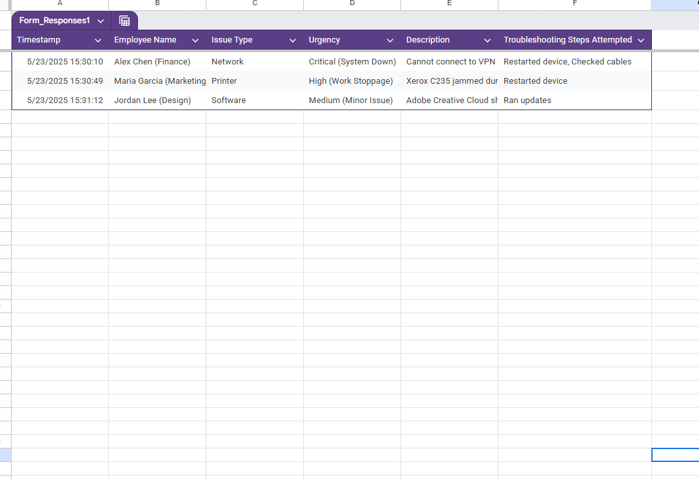

# Mock Help Desk Ticketing System

This project simulates a basic IT help desk workflow using Google Workspace tools. It allows internal users to submit tech issues, which are tracked and prioritized in real time.

## 🚀 Features
- Automatically assigns sequential ticket IDs (TKT-1001, TKT-1002, …) in a dedicated "Ticket ID" column
- Optional auto-email ticket confirmation with urgency level (off by default)
- Logs submissions with timestamps, issue type, urgency, and attempted steps
- Supports IT triage and visibility for small teams

## 📦 Tech Stack
- **Google Forms** (for user input)
- **Google Sheets** (for tracking)
- **Google Apps Script** (for automation)

## ⚙️ Setup
1. Create a Google Form with questions named **Issue Type**, **Urgency**, and **Steps Tried** (and turn on *Collect email addresses* if you want confirmation emails).
2. Link the form to a Google Sheet (Responses → Link to Sheets).
3. In the sheet, open **Extensions → Apps Script** and paste in `ticket_script.gs`.
4. Add a trigger: **Triggers → Add Trigger → `onFormSubmit` → From spreadsheet → On form submit**.
5. To send confirmation emails, set `SEND_EMAIL = true` at the top of the script and approve the Gmail permission prompt.

The script adds a **Ticket ID** column on the first submission. It never writes over the form's own columns.

## 📸 Example Sheet

## 💡 Real-World Skills Demonstrated
- Ticketing systems & workflows
- Google Apps Script automation
- Technical communication
- Prioritization logic for support teams

## 🛠️ Recent Updates (November 2026)
- **Fixed:** the ticket ID was written into column A, overwriting the form's Timestamp. IDs now go in their own "Ticket ID" column.
- **Fixed:** the confirmation email crashed the script, because the address was built from the employee's name (e.g. "Jane Doe@yourcompany.com"). It now uses the form's email address field and skips the email if none was given.
- **Fixed:** email is now actually off by default (`SEND_EMAIL = false`), matching this README.
- **Changed:** ticket IDs are sequential (TKT-1001, TKT-1002…) instead of TKT-2000, TKT-3000…
- **Changed:** the script reads the submitted row from the trigger event instead of the active sheet, so it works even when the sheet has multiple tabs.
